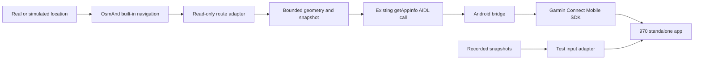

# Implementation plan: OsmAnd junction display for Garmin Forerunner 970

Status: implementation in progress. Android baseline builds, phone offline route calculation and recorded junction rendering in the actual 970 simulator are verified; live navigation delivery is not implemented. Date: 2026-11-05. Current priority: assess actual junction-layout usability with the watch simulator in the loop; defer further live transport work. Current evidence and remaining checks are tracked in [todo.md](todo.md) and [verification.md](verification.md). This plan supersedes conflicting recommendations in the frozen [research notes](research/FEASIBILITY.md).

## 1. Objective and user instructions

### Offline continuation authorized after visual approval

The user approved the filtered examples, committed checkpoint `0c6b7f8`, and
authorized continuing all useful work without the phone. Do not use ADB or
replace the selected route. Work in dependency order: (1) Java geometry + bounded
existing-OBF reader, saved-route comparison and actual watch replay; (2) coherent
snapshot/cache and optional compatible API export, build/host checks; (3) bounded
delivery/request logic and simulator tests. Reuse existing T04/T07/T08/T09 criteria.
Hardware-only installation, GPS/progress cadence, Binder/device lifecycle and
Bluetooth evidence stay open. Do not add traffic-control symbols. Keep each
checkpoint independently reviewable and update evidence before continuing.

OsmAnd navigates on an Android phone, using its built-in calculated routes and downloaded maps. A standalone Connect IQ app on a Forerunner 970 shows a compact upcoming-junction sketch with the chosen route highlighted. It must distinguish common forks and closely spaced turns better than a generic arrow.

User clarification: the watch shows a STABLE next-junction layout with all recognizable mapped road arms and ONLY the selected route yellow. No moving map or rider marker is required. Distance updates once per second from route-matched phone progress; small optional anticipation compensates known sample delay, bounded initially at one second. OsmAnd alone changes the next junction. Fresh GPS/progress cadence and end-to-end latency must be measured, not inferred from the display refresh rate. Review examples should pair watch-layout previews with coordinate links; the user opens the map to compare. Respect user-selected endpoints on the phone.

The user rides a motorcycle, accepts a contained source patch to the F-Droid-style Android app, and wants both wrist and mounted layouts to use the same data. Native Garmin activity recording is not required. Imported GPX navigation and external routing engines are outside v1. A GPX or coordinate trace may still be used as simulated GPS input in tests.

The user can keep the real phone and Garmin available at the computer. Repeated manual reinstalling, restoring settings, selecting a route and navigating menus is unacceptable as the routine iteration process. Build/deploy/replay/evidence collection should be automated, with human supervision and visual review. Do not describe a script that prints manual instructions as automatic deployment.

**Git workflow:** develop locally. The user subsequently explicitly authorized focused local commits for this checkpoint and requested a clean index. The user will create/configure the personal GitHub destination and push manually. Do not create a fork, install GitHub tooling/connectors, change remote destinations, push, create issues or publish anything without a later explicit request. Keep generated output and private configuration out of Git. `JUNCTION.md` records the single-repository layout and locked sibling bootstrap for another computer.

## 2. Checkout and scope of work

The relevant Android repository has already been cloned. Reuse it; do not clone another copy or clone iOS/web/server projects.

```text
Workspace: /home/davide/sviluppo/varie/osmand
Editable Git repository: /home/davide/sviluppo/varie/osmand/OsmAnd
Upstream: https://github.com/osmandapp/OsmAnd.git
Inspected base: f22eeb0c1322a9f5784eed6e4d0addb43a0c2e32
Local branch at handoff: garmin-junction-plan
Clone: shallow; approximately 158 MiB at inspection
```

The full Android Gradle project is needed even though edits are narrow. Sparse-copying only the routing files will not build an installable app. The working areas are:

| Area | Allowed purpose |
| --- | --- |
| `OsmAnd-api/.../info/AppInfoParams.java` | Add an optional navigation-snapshot Bundle with compatible serialization |
| `OsmAnd/src/net/osmand/aidl/OsmandAidlApi.java` | One small app-info hook to the exporter |
| `OsmAnd/src/net/osmand/plus/routing/companion/` (new) | Kotlin route adapter, snapshot lifecycle/cache and Bundle conversion |
| `OsmAnd-java/src/main/java/net/osmand/router/junction/` (new) | Plain Java geometry/data logic, without Android dependencies |
| `OsmAnd-java/src/test/java/net/osmand/router/junction/` (new) | Focused geometry tests |
| `OsmAnd/test/java/net/osmand/plus/routing/companion/` (new) | Android/API integration tests |
| `OsmAnd/src-debug/` (new, explicitly debug-only) | Automated scenario controller, if existing APIs cannot provide reliable lifecycle control |
| `integrations/garmin/` (new) | Independently built Android bridge, Monkey C watch app, contracts, public fixtures and development tooling |
| `tasks/` | Plan, task status and concise review summaries |

Read [AGENTS.md](../AGENTS.md) before editing. Preserve Java in Java-only modules and existing Java files; prefer Kotlin in the Android module and new bridge. Do not modify `OsmAnd-shared` for this feature. Do not change routing decisions, voice logic, native algorithms, map-file formats, subscription behavior or the main map renderer. A small null-safe route-data accessor is allowed only if extraction needs it and is covered by a focused test. Do not load arbitrary plugin code or use reflection to reach route internals.

### Build-only dependencies

The editable repository is conventionally called `android` upstream, but its existing local name `OsmAnd` is valid: build paths depend on its sibling directories. Do not rename the checkout.

```text
osmand/
  OsmAnd/        # editable Android repo, including API and Java routing modules
  resources/     # OsmAnd-resources, build input only
  core-legacy/   # OsmAnd-core-legacy and its required externals, build input only
  core/          # only if a compatible packaged OpenGL core cannot be used
  build/         # OsmAnd-build only when required by the selected build route
```

In T00/T01, clone only required missing build inputs from the repositories named by the [official development setup](https://osmand.net/docs/technical/build-osmand/setup-the-dev-environment/). Record their resolved commit IDs and artifact hashes. Do not recursively synchronize the whole OsmAnd manifest: it includes unrelated iOS, web, help and server projects. A matching native binary may be used for development if its provenance/version is recorded; do not present this as a fully reproducible F-Droid source build. Rebuilding every F-Droid dependency from source is not a v1 requirement.

Keep the inspected app commit as the starting baseline. Change to a release-based baseline only if the unchanged baseline cannot build with a bounded, documented setup fix or the user requests it. In that case record the new commit, revalidate all referenced APIs and do not silently rewrite the plan around missing features. The exact installed OsmAnd~ version is useful information, not a reason to block initial development on a separate test installation.

## 3. Chosen architecture



OsmAnd owns maneuver selection, route progress, route matching and recalculation. The new code reads that result. It must not calculate a second navigation route on the bridge/watch. No Garmin SDK dependency is added to OsmAnd. The bridge reads the locally built AIDL library and communicates with Garmin Connect; it does not require an application server.

The bridge and watch are standalone builds under `integrations/garmin/bridge/` and `integrations/garmin/watch/`. Do not include them in OsmAnd's main `settings.gradle`. The bridge consumes the AAR built by `:OsmAnd-api:assembleDebug` via an explicit configurable file dependency or equivalent verified packaging. Do not copy an outdated second set of AIDL source declarations. The API module assumes OsmAnd's root build layout, so directly including it as a subproject of an unrelated Gradle root needs care and is not the default approach.

### App identity and installation

Use the F-Droid-style `androidFull` flavor with a distinct development application ID, default `net.osmand.plus.junction`. A debug-only application-ID suffix is acceptable; confirm provider authorities and service binding use the actual installed ID. Preserve namespace/source packages. Keep the user's F-Droid-signed `net.osmand.plus` installation intact.

Proposed target command to verify in T01: `./gradlew :OsmAnd:assembleAndroidFullOpenglArm64Debug`. Discover and record the exact task rather than assuming the command works. `legacy` is not a substitute for the final routing-engine test. Use an ARM64 device build once `adb shell getprop ro.product.cpu.abilist` confirms support. An x86 emulator build is optional.

Install once, then use update installation with stable signing and identity. Never run `adb uninstall`, clear application data or reset maps/preferences as part of a normal iteration. The Garmin app UUID and development signing key must also remain stable. Keep private keys and local SDK paths outside Git, referenced through local configuration. Physical watch file-transfer mode, application launch and reconnect behavior must be measured in T02/T03 before promising unattended physical deployment.

## 4. Data contract to implement

T04 writes the machine-readable schema and examples. The following choices are fixed defaults unless measured platform limits require a documented adjustment.

### AIDL envelope

Add an optional top-level Bundle field, named `navigationSnapshotV1`, to `AppInfoParams`, with getter/setter and `writeToBundle`/`readFromBundle` handling. Keep the existing constructor, old keys, `turnInfo` contents and null semantics. Old clients must ignore the extra key; new clients must handle its absence. No new Binder method or custom Parcelable is needed for v1.

Populate it in `OsmandAidlApi.getAppInfo()` through a dedicated provider. Preserve existing permission checks. Current `getAppInfo` is in the LOCATION permission group; navigation callbacks use NAVIGATION and `setLocation` uses SYSTEM. Do not bypass permissions to make a test pass. Extra test-only location controls must not accidentally ship in release.

### Snapshot semantics

Required information:

- Schema version, navigation-session ID, route generation, geometry ID, and source sample sequence.
- Navigation state: `idle`, `active`, `paused`, `recalculating`, `off_route`, `arrived` or `unavailable`, with a reason when needed. If cancellation/arrival cannot be distinguished on the selected baseline, prove the limitation and specify a conservative state mapping before writing tests that assume them.
- Distance in integer meters; maneuver type; optional roundabout exit number, road name and next maneuver. Unknown values are absent/explicitly unknown, never fabricated as zero.
- Source sample time and last-location age. Android may use `elapsedRealtime` internally across its processes. The bridge transmits bounded ages/TTLs to the watch rather than expecting synchronized phone/watch clocks.
- Local road polylines, selected-route identity, maneuver anchor(s), geometry mode (`route_only`, `routing_branches`, `unavailable`) and a reason when limited. This describes data capability, not a promise that every physical road is present.

Native route data is captured coherently on the appropriate existing thread/lock boundary. Do not hold a routing lock while simplifying geometry or sending messages. Recheck route generation before publishing asynchronous work and discard obsolete results. Recalculation may retain the old route temporarily; it must not leave an old highlighted choice presented as confirmed new guidance. Reuse actual route-point/segment indexes and identity; nearest-coordinate matching alone is insufficient for loops and bridges.

### Coordinates and geometry

Use a local metric scene centered on the maneuver cluster. Orient the phone-generated scene using the selected route's approach tangent, with approach entering from below. Define axes explicitly in the schema: positive x is rider-right, positive y is forward/up. Store bounded integer decimeters on the wire. The watch scales/translates to pixels and inverts y for screen coordinates; it does not use the wrist compass to rotate the scene.

Initial configurable bounds: at most 8 paths, 24 points per path and 96 points total, normally within a 200 m radius. These are engineering bounds, not Garmin capacity guarantees or a mandatory zoom level. Start with a 1 m simplification tolerance while retaining decision anchors. Keep selected-route points and junction nodes before decorative shape points. If bounds would hide a relevant branch, overflow or merge distinct junctions, return a limited view rather than silently dropping the information. Bounds/tolerance may be revised only with fixture evidence.

Extract the selected approach/departure from the calculated route. Deduplicate by connectivity/road direction and sampled geometry; do not merge roads just because their bearings are close. Preserve adjacent junction anchors and shared road vertices. Treat disconnected crossings as disconnected. Attached and pre-attached routing roads may be filtered and cannot prove the full recognizable layout. Following the user's full-layout clarification, a bounded local read-only query of the EXISTING OBF using OsmAnd's own reader is permitted. The current desktop diagnostic queries a 400 m box and clips to a 75 m display circle (80 m scale). No second map database, native-routing modification or unbounded query is introduced. Context lines have no claimed anchor connectivity. The level-aware context mode now draws bridges/tunnels in order without dropping gray alternatives; building passages alone do not suppress context. Unsupported metadata and true overflow still return an explicit limited view.

The full-layout requirement includes recognizable roundabout shape and visible approaches/exits where available in the map. The earlier exemption for an all-exit diagram is superseded by the user's clarification. Missing roads, unreadable geometry or unsupported grade separation must be explicit; a generic symbol or selected-route-only view does not satisfy this gate.

Subsequent visual feedback explicitly permits filtering out non-motor footpaths/cycleways, which solid gray strokes made misleading. Apply highway/access hierarchy defaults with motor-permission overrides, preserve ordinary tracks/service roads and the calculated yellow route, and keep an omission audit. Do not filter solely from dashed map styling or claim country-specific legal access. Traffic-light landmarks and approach-specific stop signs are possible later additions; the user explicitly deferred implementation of both.

Measured context scenes contain 29–30 paths and 88–113 points. The draft `map_context` budget is therefore 32 paths, 48 points/path and 512 points total; legacy routing-branch scenes retain 8/24/96. These remain bounded prototype limits, not certified physical Bluetooth capacity. Capacity overflow clears competing context and marks the scene limited; never silently drop road arms to fit. SDK serialization and normal-app 40-path/512-point rendering now have measured evidence. Layered context permits 40 paths with shorter 24-character path IDs; ordinary mode stays at 32. See the implemented contract and latest verification checkpoint.

### Bridge-to-watch delivery

Start with compact self-contained snapshots at a proposed maximum of 1 Hz, using **watch-initiated request/response**. The watch sends a request ID, the bridge responds with the latest coherent snapshot echoing that ID, and the watch accepts it only while that request remains current and within its local deadline. This bounds the age of a newly received delayed reply without requiring synchronized phone/watch clocks. T03 must verify both communication directions. Allow one outstanding request and one response send in flight; after a timed-out request, reject its late response. Do not queue a history of snapshots. A send-success callback is not proof of a rendered frame.

The watch normally requests again after roughly one second, once the previous exchange completes. A response deadline of 3 seconds is the initial test setting. Use the watch's own elapsed request time as a conservative bound for transport time: add it to the supplied source/fix ages before applying freshness limits. The full round trip overestimates the response transit time, which is conservative. Rendering acknowledgments can be carried in the next request. On reconnect, clear the old pending request and require a new request ID/connection epoch. V1 uses no unsolicited application snapshots: navigation cancellation/state changes arrive in the next requested response, while the platform's disconnect callback can invalidate guidance immediately. Verify actual encoded size, heap and delivery behavior in T03; do not invent a payload ceiling.

Use the same field names/units in fixtures and live messages, mapping to supported SDK dictionaries/arrays/scalars. Keep numeric IDs and ages within measured Monkey C number ranges; avoid transmitting epoch milliseconds as an assumed 32-bit integer. Session IDs may be strings. Acknowledge the displayed session/generation/sequence for test evidence, at a bounded rate.

Initial configurable thresholds for testing: transport-stale indication after 3 seconds without accepted live data; stale-source/position indication when the conservative source/fix age (reported age plus elapsed request time) exceeds 5 seconds. They are prototype defaults, not validated riding-warning thresholds. Receiving a heartbeat must not refresh an old GPS fix. Invalid packets, expired/superseded request replies and old-generation packets do not reset freshness. Explicit cancellation, reroute and disconnect invalidate any cached selected instruction immediately when received. Specify clock-wrap handling in the actual watch implementation.

Delta geometry/progress messages are deferred. Introduce them only if real size/throughput measurements demand it, and add recovery tests for missing geometry, reorder and reconnect. Cache is allowed; offline watch navigation independent of the phone is not.

## 5. Test architecture and automation contract

### Three kinds of evidence

1. Plain-data geometry/protocol tests: controlled inputs and clock; run without physical devices.
2. Actual Monkey C code in the 970 simulator: same decoder, navigation state and renderer as live messages; synthetic or captured fixtures enter through a small input adapter.
3. Physical desk scenarios: actual OsmAnd engine, AIDL, bridge, Garmin Connect, Bluetooth and actual watch. No travel required. Simulated movement is the only substituted input for a normal end-to-end scenario.

Both GPS-input replay and snapshot replay are necessary. Snapshot replay cannot validate OsmAnd extraction. GPS-input replay must drive actual off-route/recalculation, rather than injecting a prerecorded reroute result. Never replace the production geometry/state/renderer with a separate test implementation.

### Proposed tooling interface

The commands below are **requirements for scripts to be written, not existing or executed commands**. Invoke from the editable repository root. T00/T01 must record the real Gradle/SDK commands they wrap.

```text
python3 integrations/garmin/dev.py doctor --out build/garmin-review/environment
python3 integrations/garmin/dev.py build --target osmand|bridge|watch|all --out <run-dir>
python3 integrations/garmin/dev.py check --suite geometry|api|protocol|watch|all --out <run-dir>
python3 integrations/garmin/dev.py run --mode replay|desk --scenario <id> --speed 1 --out <run-dir>
python3 integrations/garmin/dev.py iterate --mode replay|desk --scenario <id> --out <run-dir>
```

`doctor` is read-only and produces actionable readiness status. A missing tool/device must never produce a passing integration result. Use the repository Gradle wrapper; a global Gradle installation is unnecessary. Paths and device selection come from local configuration with a committed example, not a developer's hardcoded home directory. Select an ADB serial explicitly when more than one device exists. Run actual builds/tests with captured exit codes; no blanket success after a failed subprocess.

`iterate` performs incremental build(s) for changed components, update installation, launch, scenario restoration/start, completion wait and evidence collection. Preserve app data. Garmin SDK/compiler or app changes require a watch rebuild; geometry fixture/view iterations should normally use the simulator. A bridge-only change must not cause an OsmAnd rebuild/reinstall. Keep unrelated adb/logcat traffic out of the run's log.

Run output belongs under the existing ignored `build/garmin-review/`, not a new tracked diagnostic directory. Do not modify `.gitignore` merely to hide output. Each run has a unique ID, component hashes, scenario ID, source/dependency/map versions, device/firmware metadata, command log, structured events, test report and result status (`pass`, `fail`, `blocked`, `not_run`). Missing output cannot be interpreted as success. Logs must distinguish last source sample, last valid received packet and last drawn frame.

For a physical run, automatically collect Android/export/bridge events and watch acknowledgment/counters. Use simulator screenshots for automatic frame comparisons. Do not pretend an Android screenshot proves the physical Garmin display. Hardware visual checks may require a human to inspect the watch and explicitly record a verdict; identify that step in the run report. Do not require the user to photograph every iteration.

### Repeatable scenario setup

Use a small public-map region containing the chosen test junctions. Fixture manifest records map SHA-256/version, routing engine/profile/settings, explicit start/destination/intermediate coordinates, trajectory times and expected maneuver/branch choices. Choose public test locations, not personal home/ride logs. No need for the user to select locations before baseline work: implementer may select reproducible public junctions and document them.

Set up the test installation's map/profile/connected-app grants once. A scenario run initializes only that test instance, calculates the requested route and waits for a concrete `route_ready` condition. Use the existing simulation APIs. If programmatic start/reset of built-in simulation is not reliably exposed, implement the smallest debug-only controller in `OsmAnd/src-debug/`, wired explicitly to the debug source set and debug manifest. **Main Java sources are recursively read from `OsmAnd/src`; do not put debug controllers under `src/debug/java`, where this layout could include them in main.** Verify their absence from a release APK or release merged source/manifest output.

The controller accepts a named scenario, not arbitrary commands. It invokes the normal navigation/simulation entry points, reports run status, and restores changed test-only settings after normal completion/failure. A restart can reset its own scenario state without clearing application data. Background/screen-off behavior must be tested separately: AIDL `setLocation()` currently depends on a MapActivity receiver and is not assumed to survive all lifecycle states.

The first `desk` run may require USB debugging trust, runtime permissions, the connected-app grant and pairing confirmation. Record these once. For subsequent runs, zero route-selection/menu-navigation steps is the target. T02/T03 must prove whether physical Garmin build update/launch can be automated on this setup. If USB mode/eject/button interaction remains unavoidable, report exactly what and how often; prioritize replay/simulator runs and do not falsely mark hardware deployment fully automatic. If repeated manual interaction would dominate iteration, produce an automation blocker for review before adding feature scope.

## 6. Required scenarios and assertions

| ID | Input | Required assertion |
| --- | --- | --- |
| `crossroads` | Calculated route through ordinary junction | Correct selected route and visible known alternative branches; stable approach-up orientation |
| `fork` | Two plausible similar-direction exits | Chosen exit distinguished; branch order and node connectivity preserved |
| `double-turn` | Two close junctions | Two anchors retained; first/second turn not combined or switched early |
| `roundabout` | Calculated roundabout route | Correct exit number and unambiguous selected route cue; honest geometry mode |
| `bridge-crossing` | Roads cross without connection | No false connected branch added |
| `reroute` | Movement deliberately leaves planned route | Actual engine recalculation observed; old generation cannot overwrite replacement |
| `pause-cancel-arrive` | Normal navigation lifecycle actions | Guidance clears/changes correctly; cached route not left active |
| `source-stall` | Bridge continues, source sample/fix freezes | Watch shows source stale despite incoming messages |
| `link-gap` | Drop accepted packets for >3 seconds | Watch stale; newest coherent frame restored on reconnect |
| `reorder-invalid` | Old generation, duplicate, bad schema, malformed coordinates | Rejected without crashing or refreshing freshness |
| `geometry-limited` | Missing/overflow branch data | Explicit limited view; no invented completeness |
| `screen-off` | 30-minute 1x simulated trip with phone locked | No unexplained >5-second active-data gap; failures preserved, not retried away |

The first three scenarios require actual extracted geometry as well as plain-data fixtures. Failure scenarios can use targeted transport/source fault injection with the injection point identified. Prove at least one real Bluetooth disconnect/reconnect on the bench in addition to simulated packet gaps.

Freeze expected choices by inspection against the underlying map and calculated route. Do not generate expected branch ordering with the code under test. Screenshot goldens are useful after semantic correctness is established; never auto-approve changed goldens. For accelerated tests, adjust the test clock explicitly. For latency/endurance claims, use real-time playback and record sample counts and maxima/distributions; do not convert accelerated simulator timing into physical Bluetooth performance.

## 7. Task order and review checkpoints

Task details and acceptance checklists are in [todo.md](todo.md).

```text
T00 environment/source lock -> T01 unchanged Android baseline
T00 -> T02 Garmin SDK/simulator and stable app identity
T01 + T02 -> T03 physical echo and deployment feasibility
Checkpoint A: build + actual connection + automation constraints established
T03 -> T04 contract -> T05 replay through actual watch code
T01 -> T06 actual route adapter -> T07 bounded geometry
T04 + T06 + T07 -> T08 optional AIDL snapshot
Checkpoint B: real fork and double-turn geometry is useful; API compatibility holds
T03 + T04 + T08 -> T09 live bridge
T05 + T09 -> T10 first physical end-to-end junction
Checkpoint C: real route, real data path, actual Garmin diagram
T10 -> T11 deterministic scenario control -> T12 incremental deploy runner
T12 -> T13 ambiguity regression -> T14 failure regression
T13 + T14 -> T15 one-command unattended desk scenario
Checkpoint D: repeatable iteration without repeated setup menus
T15 -> T16 long-run/device validation -> T17 final review package
```

No proactive multi-agent work is needed. Work in order with small focused changes. A task expected to touch more than about five meaningful source files should be split into explicit substeps before coding. Review checkpoints require an evidence summary; they are not automatic user-approval prompts. Continue passed, already-authorized work unless the user schedules a pause. Stop dependent work for a real failed gate, preserve evidence and explain the concrete issue; never conceal failure by substituting synthetic data.

## 8. Definition of done

### Per task

- Its acceptance criteria pass, with real command/exit-code evidence and named output artifacts. Checked boxes alone are not evidence.
- Tests cover meaningful behavior, not merely a copy of implementation logic. Failure reproduction is retained when applicable.
- The narrowest relevant build/tests pass; `git diff --check` passes. Broader checks run only for a change that warrants them.
- Existing API behavior and the user's installed app/data remain intact. Test controls are debug-only.
- Status/evidence and any new measured constraints are updated in `tasks/todo.md` and integration docs. No unrelated refactor, generated output, SDK archive, private key or personal location log is staged.

### Whole feature

- A developer can follow recorded setup commands and build the selected Android APK, bridge APK and 970 PRG from the pinned inputs.
- A single iteration command reuses the initialized test setup, applies incremental updates, restores a scenario and produces a review bundle. Remaining human interactions are enumerated and accepted explicitly by the user if they prevent the desired workflow; do not silently redefine automation as a manual sequence.
- Common crossroads, a real fork and real double-turn examples show correct, useful geometry on the actual Garmin. Roundabout exit guidance and limited-data fallback work.
- Navigation state, cancellation, reroute generation, invalid/old messages and independent source/transport freshness pass the scenario suite.
- Screen-off 30-minute real-time run has no unexplained active-data gap above the 5-second source-stale threshold. A 60-minute watch run reports memory/crashes and battery/display observations; endurance cannot be inferred while charging.
- Worst-case bounded geometry fits measured API/message/heap limits with documented headroom. No growing packet queue; watch decoder remains responsive.
- Both layouts use the same scene/protocol. Detailed styling remains deliberately small; no touchscreen interaction is required during routine navigation.
- All unexecuted checks are labeled. Readability in actual riding conditions remains a separately disclosed limitation; motorcycle travel is not required to pass software development/regression gates.
- The original reviewing agent receives T17's evidence index and patch, not a claim that everything works without supporting output.
- Forking, committing and pushing remain for the user.

## 9. Review packet and implementation reporting

At each checkpoint produce `build/garmin-review/<run-id>/summary.md` with:

1. Base commit, working diff identifier/hash, SDK/dependency/map/firmware versions.
2. Task/scenario IDs, actual commands, exit codes, start/end times and output paths.
3. Which code paths were real, simulated-input, fixture-only or not executed.
4. Semantic results, representative simulator frames, hardware acknowledgment and human visual verdict where required.
5. Maximum/typical source/transport/render ages with measurement method, packet sizes, dropped/replaced packets, crashes and failures.
6. Exact residual manual actions, blockers, proposed scope changes and next task.

The final packet additionally contains `git diff --stat`, `git diff --check`, staged/unstaged/untracked inventory, API compatibility matrix, scenario result matrix, reproduction instructions and review priorities. Store generated bulk evidence in ignored `build/`; keep a short tracked results index in `tasks/verification.md` after tests actually run. Do not check in raw device IDs, signing keys or private logs.

## 10. Known constraints and escalation boundaries

Observed at planning: Java 21 installed; Android/Garmin tools absent from PATH and standard directories; `/dev/kvm` not exposed to this session. This does not prove absence on the user's real host. Android native/dependency setup and physical-device access must be established; no scripts in this plan have run yet. Use the wrapper and verify JDK compatibility against the pinned Gradle/AGP versions; bytecode target 17 does not by itself dictate the host JDK.

Important source findings: attached arrays can be absent/cleared; `RouteCalculationResult` repeats segment references across route points; native attachments are not a complete physical road graph; some public helper logic is speech-filtered. Test these rather than broadly fixing unrelated code. Capturing only the currently spoken turn can skip a junction needed in the displayed neighborhood; use the selected route's indexed geometry for the neighborhood while retaining OsmAnd's maneuver semantics.

Pause dependent implementation and request review for: ordinary fork/double-turn geometry requiring a new map-query engine; a change to native routing/format; failure to build a known baseline after bounded setup diagnosis; inability to produce a tolerable automatic iteration loop; or transport/display constraints that invalidate the chosen presentation. Provide a concrete failed test and the smallest proposed alternative. Do not ask for permission for ordinary reversible edits, reads, focused tests or authorized local builds.

Reference facts are in [research/FEASIBILITY.md](research/FEASIBILITY.md) and [research/garmin-platform-research.md](research/garmin-platform-research.md). Research links are not evidence that this implementation builds or works.

## 11. Planning-document verification

The author checked that all 18 tasks T00–T17 exist; each has three acceptance criteria, dependencies, verification and a named verifiable output; all dependency IDs resolve and the graph is acyclic. Local Markdown links, code fences and trailing whitespace were checked. Git whitespace checks are part of final staging verification. These are document checks only. No proposed development command, application build, simulator session or device scenario has run.


## 13. Unattended Waydroid validation (2026-11-06)

The user authorized autonomous map setup, navigation simulation, live export tests
and additional coordinate-linked junction previews, minimizing physical-only work.
Execute T11's desk-control subset before physical T10: debug/DUMP-only current-route
simulation and actual cross-process API sampling; no routing-engine changes.
Verify map/profile and saved endpoints; sample at 1 Hz and keep actual fix cadence
separate. Exercise pause/resume, stopped fixes, restart/permission loss and source
recovery. Then replay ACTUAL exported scenes in Garmin's simulator and leave a
labeled review gallery. Live Garmin transport remains a separate bounded test;
Bluetooth and physical-watch readability cannot be inferred from a desk pass.
All raw captures, coordinates and generated outputs stay under ignored build/.

## Live simulator transport refinement (2026-11-06)

Actual SDK integration exposed its tethered 600-byte/second sleep model. Full
nested scene dictionaries missed the three-second reply deadline. JC1 lossless
encoding now adapts only the SDK boundary; it preserves the logical API/envelope
and all freshness rules. See integrations/garmin/wire.md for byte format, evidence,
alternatives and unresolved maximum-scene throughput/replay-memory limits. The
user explicitly requires a connected demo and documentation of workarounds.
