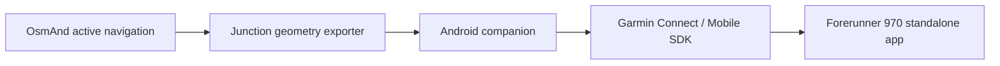

# Live OsmAnd junction display on Garmin Forerunner 970

Frozen research snapshot. Follow `../plan.md` and `../todo.md` for implementation; their latest checkout, automation and user-managed fork/push instructions override earlier alternatives below.

Research date: 2026-11-05. Target confirmed by user: Android phone and Forerunner 970, **standalone watch app for motorcycling**, using **routes calculated by OsmAnd**. The user uses the F-Droid version and permits modifying it or using a plugin, with a strong preference for a contained change whose benefit justifies maintenance. Purpose: OsmAnd actively navigates on the phone; the watch displays a compact, minimally ambiguous representation of the upcoming junction. Wrist and bike-mounted layouts can share the same data protocol; mounting is not a prerequisite for transport work.

## Assessment

**Feasible as a custom integration.** Phone-to-watch navigation cues and vector drawing have supported interfaces. The difficult part is producing a faithful junction diagram from the active route and nearby roads. Stock OsmAnd's public navigation API supplies maneuver information, but does not expose the surrounding junction graph in the inspected interface.

Recommended architecture for the clarified use: a **contained, read-only navigation snapshot extension to OsmAnd's existing AIDL app-info API**, a separate Android/Garmin bridge, and a **standalone Connect IQ device app**. Keep routing, route matching and map rendering in OsmAnd. Reuse the calculated route and its attached road segments for a bounded local junction sketch. Native Garmin activity recording, independent map-data storage and universal GPX support are outside the first version. The concrete scope and technical boundary are specified below.

This is a source-and-documentation feasibility study, not an end-to-end tested integration. No Android APK or Connect IQ app was built, installed or exercised on the user's hardware. Current source may differ from the user's installed OsmAnd release and watch firmware.

## Selected narrow solution

### F-Droid baseline

Assuming the standard **OsmAnd~** listing, F-Droid identifies the source as upstream OsmAnd and builds it through its OsmAnd-submodules mirror with build-time adjustments. It is not a separate navigation engine that must be investigated from scratch. Match the user's installed release and corresponding F-Droid build recipe before implementation; the checkout inspected here is upstream master, not a verified match to the installed APK. [F-Droid listing](https://f-droid.org/packages/net.osmand.plus/), [build metadata](https://gitlab.com/fdroid/fdroiddata/-/raw/master/metadata/net.osmand.plus.yml).

### Plugin finding

The documented installable `.osf` plugins are packages of configuration and resources: profiles, maps, menus and related assets. In the inspected code, `CustomOsmandPlugin` reads JSON and imports resources. It does not load an arbitrary native Kotlin/Java extension that can inspect the internal route. [Custom-package documentation](https://osmand.net/docs/user/plugins/custom/), [CustomOsmandPlugin](https://github.com/osmandapp/OsmAnd/blob/f22eeb0c1322a9f5784eed6e4d0addb43a0c2e32/OsmAnd/src/net/osmand/plus/plugins/custom/CustomOsmandPlugin.java).

An internal code plugin can use `OsmandPlugin` and existing route/location hooks, but those plugins are registered in source and compiled into OsmAnd. A separate installed companion still has only the external API's data. Therefore a compiled plugin does not eliminate the APK rebuild. For this single export capability, an isolated API helper is the smaller first implementation; a plugin entry can be added later if a dedicated enable/disable UI becomes useful. [Built-in plugin registration](https://github.com/osmandapp/OsmAnd/blob/f22eeb0c1322a9f5784eed6e4d0addb43a0c2e32/OsmAnd/src/net/osmand/plus/plugins/PluginsHelper.java#L107), [plugin base](https://github.com/osmandapp/OsmAnd/blob/f22eeb0c1322a9f5784eed6e4d0addb43a0c2e32/OsmAnd/src/net/osmand/plus/plugins/OsmandPlugin.java).

### Change boundary

This is the chosen design direction, not implemented code:

1. Add one optional, versioned navigation-snapshot Bundle to `AppInfoParams`, populated through the existing `getAppInfo()` call. Keep existing fields and their null semantics intact. A new optional Bundle key can be ignored by existing clients because this Parcelable already serializes through named Bundle entries; verify old/new combinations in a compatibility test. Use primitive values and primitive arrays, avoiding new parcelable types and new AIDL methods in this first version. [AppInfoParams](https://github.com/osmandapp/OsmAnd/blob/f22eeb0c1322a9f5784eed6e4d0addb43a0c2e32/OsmAnd-api/src/net/osmand/aidlapi/info/AppInfoParams.java), [Bundle serialization](https://github.com/osmandapp/OsmAnd/blob/f22eeb0c1322a9f5784eed6e4d0addb43a0c2e32/OsmAnd-api/src/net/osmand/aidlapi/AidlParams.java).
2. Put route inspection, bounded geometry extraction and caching in a dedicated helper/package. The existing app-info construction calls that helper. No Garmin SDK enters OsmAnd. Do not change routing decisions, native routing code, map-file formats, map rendering or the existing maneuver-selection algorithm.
3. Use the current calculated route's maneuver offsets, route locations and segment mapping. Extract a short route approach/departure and short polylines for known adjoining branches. Inspect a bounded neighborhood when two decisions are close. Cache by route generation and maneuver; update distance/state cheaply between geometry changes. Do not scan the whole map or regenerate geometry at every GPS fix. [Route point and segment access](https://github.com/osmandapp/OsmAnd/blob/f22eeb0c1322a9f5784eed6e4d0addb43a0c2e32/OsmAnd/src/net/osmand/plus/routing/RouteCalculationResult.java#L1034).
4. Keep each snapshot coherent with one route generation. Use appropriate thread confinement/copying and invalidate cached geometry when the route changes. Export idle, paused, active, recalculating and off-route conditions rather than leaving the last arrow on screen indefinitely. Exact state behavior must be tested, including recalculation that retains the old route temporarily.
5. Let the Android companion use the existing connected-app permission flow, poll the snapshot at an initially modest rate and relay it through Garmin Connect. It can send geometry once and distance/state updates separately. Let the watch draw the same scene in wrist and mounted layouts.

### First-version value and limits

The target is a small **junction sketch with the selected route highlighted**, plus distance, road name and roundabout exit number when provided. The value beyond a basic arrow is seeing the relative shape and order of known branches at ordinary intersections and forks, and preserving two nearby turns as separate decisions.

First-version support is for routes calculated by OsmAnd's built-in routing engine. A road profile alone does not prove an external engine supplies the same segment data; the exporter must check what the calculated route actually contains. Imported/raw GPX and external routing services are separate future cases.

Do not promise a complete physical junction from routing attachments. One-way filtering and other preparation rules can omit visible branches. Export a geometry-capability/status value distinguishing route-only data from routing-branch geometry; nonempty attachments do not prove completeness. When available data cannot represent the decision honestly, show a limited maneuver view. Roundabout exit numbers are in scope; exact layouts of all exits are conditional on available geometry. Complex interchange reconstruction and a general offline map-query engine are deferred.

### Effort gate

The first milestone should prove the distinguishing value: **one real fork and one pair of closely spaced turns, extracted from a calculated OsmAnd route and displayed correctly on the Garmin, followed by a reroute that replaces them correctly**. A successful Bluetooth link or a canned junction graphic alone is insufficient.

Before implementation, make an unmodified build of the selected source baseline and establish how the test APK will be installed. Initial OsmAnd build setup is a material part of the effort even if the feature patch is small. A locally signed build cannot normally update an F-Droid-signed installation with the same application ID; prefer a separate application identity for testing, with explicit setup of maps/preferences for that installation. This keeps the user's current installation available while validating the feature. [Android signing and update rules](https://developer.android.com/studio/publish/app-signing).

Proceed with the contained exporter if the existing route data produces useful real junctions. If ordinary test cases instead require broad map-query or native-routing changes, reassess before adding that machinery. This bounds the investigation while preserving a path to the actual requested benefit.

### Desk testing is a first-version requirement

The user requires development and regression testing without motorcycle rides. Use the real routing engine and production message/renderer paths with simulated location input. Do not build a second implementation of navigation for testing.

The user confirms the physical phone and Garmin can remain available for development. **Use physical-device desk tests as the primary integration gate; full Android emulation is optional.** Use replay and the Garmin simulator for rapid iteration. The user will create a personal GitHub fork and supply its URL; do not create it or require a GitHub CLI/connector setup on their behalf. Keep the OsmAnd patch and implementation history in that fork.

**Iteration workflow requirement clarified by the user:** minimize repeated manual reloads, installation steps and scenario setup. Attached physical devices and automatic update/deployment are welcome; human supervision and visual review remain expected. The implementation plan must provide a repeatable build → deploy/update → launch → scenario replay → evidence collection workflow, preserving app data and test setup between iterations where supported. Prove which steps can be automated on Android and on the physical Garmin; explicitly identify residual physical-device actions instead of promising universal hot reload. Use the simulator/replay loop to avoid unnecessary watch deployments during layout iteration. Do not equate permission for occasional human supervision with acceptance of a manual setup sequence on every change.

**Simplest end-to-end setup:** the real Android phone and Forerunner 970 remain on a desk. Calculate a route in OsmAnd and use its existing navigation/location simulation, then run the exporter, bridge, Garmin Connect and watch app normally. This exercises real Bluetooth and real watch rendering without travel. OsmAnd's simulation starts from the calculated route and calls `setLocationFromSimulation()`, which goes through location/routing updates. [Simulation implementation](https://github.com/osmandapp/OsmAnd/blob/f22eeb0c1322a9f5784eed6e4d0addb43a0c2e32/OsmAnd/src/net/osmand/plus/simulation/OsmAndLocationSimulation.java), [simulation thread](https://github.com/osmandapp/OsmAnd/blob/f22eeb0c1322a9f5784eed6e4d0addb43a0c2e32/OsmAnd/src/net/osmand/plus/simulation/LocationSimulationThread.java), [location-provider path](https://github.com/osmandapp/OsmAnd/blob/f22eeb0c1322a9f5784eed6e4d0addb43a0c2e32/OsmAnd/src/net/osmand/plus/OsmAndLocationProvider.java#L747).

The development plugin also supports a supplied GPX movement trace and playback speed. A trace can deliberately depart from the intended route to exercise real off-route detection and recalculation. Its role here is simulated GPS movement; the navigation route remains calculated by OsmAnd. For repeatable runs, prefer fixed input positions/timestamps and fixed-speed simulation; the existing realistic mode adds random noise. Confirm fixture runs actually produce the intended deviation/recalculation instead of merely following the original route. [Official simulation documentation](https://osmand.net/docs/user/plugins/development/).

**Computer-only development setup:** run OsmAnd and the bridge together inside an Android emulator, replay location using the emulator's route/GPX controls, and run the actual Monkey C app in Garmin's Connect IQ simulator using the 970 device profile. Android documents route playback and GPX/KML location import. Garmin documents device-profile simulator runs and has documented ADB/tethered companion-to-simulator communication. The exact current mobile-SDK transport setup and combined emulator connection remain to be verified; this desk architecture has not been run here. It substitutes a simulator transport for wireless Bluetooth, so it cannot establish real-radio reliability. [Android location replay](https://developer.android.com/studio/run/emulator-extended-controls#location), [Garmin simulator workflow](https://developer.garmin.com/connect-iq/connect-iq-basics/your-first-app/), [Garmin staff clarification of tethered transport](https://forums.garmin.com/developer/connect-iq/f/discussion/5375/ble-simulation-over-android-debug-bridge).

OsmAnd also has an existing AIDL `setLocation()` API carrying speed, bearing, accuracy and an interval for ignoring other GPS updates. This is a possible scripted-input route, but the inspected receiver is registered against MapActivity. Do not assume it works through every background/screen-off lifecycle without a test; keep it separate from the initial built-in simulation path. [Location payload](https://github.com/osmandapp/OsmAnd/blob/f22eeb0c1322a9f5784eed6e4d0addb43a0c2e32/OsmAnd-api/src/net/osmand/aidlapi/map/SetLocationParams.java), [receiver registration](https://github.com/osmandapp/OsmAnd/blob/f22eeb0c1322a9f5784eed6e4d0addb43a0c2e32/OsmAnd/src/net/osmand/aidl/OsmandAidlApi.java#L948).

**Fast regression setup:** record versioned navigation snapshots with relative timing into small fixtures. A test input adapter feeds these into the same decoding, state handling and drawing logic used by the watch's live messages. This proposed adapter is test tooling, not an implemented feature. Keep replay/simulator-specific code outside the production exporter. Add playback controls incrementally: restart a scenario, advance a frame and change playback speed; virtual-clock tests cover exact stale-data thresholds.

Initial fixture suite:

- A fork, an ordinary crossroads, two closely spaced turns, and a roundabout.
- A simulated missed turn followed by actual OsmAnd recalculation.
- Navigation pause, cancellation and arrival.
- An instruction gap long enough to become stale; dropped/delayed packets and old-generation packets arriving after a reroute.
- Missing/partial branch geometry and its limited-view fallback.

Pin route inputs, map version, OsmAnd source revision and random seed where applicable. Approve expected road/branch choices against the route and map, rather than generating test expectations with the same extraction algorithm. Capture rendered frames at maneuver transitions and verify geometry/selected branches in addition to screenshot appearance.

Run most logic/layout iterations in replay and the simulators. Then repeat selected simulated rides on the physical phone/watch at real-time speed, including phone screen-off, Bluetooth interruption/reconnection and a long-running battery/display check. Accelerated replay does not validate real-time communication latency or battery use. Motorcycle-specific readability, vibration and visibility under actual riding conditions remain outside the emulator's coverage, but are not prerequisites for developing and regression-testing the feature.

### Development risks to resolve before the execution handoff

These are investigation findings and proposed decisions, not a completed implementation plan.

**Observed environment, 2026-11-05:** the execution environment reports Linux x86_64 and Java 21. Android `adb`, emulator and SDK manager, and Garmin compiler/simulator tools were not found on PATH. Standard Android and Garmin SDK directories were absent; no `/dev/kvm` was exposed. These observations describe this session's environment, not a complete inventory or a diagnosis of the user's physical computer. The repository has its own Gradle wrapper; absence of a global `gradle` command is not a blocker. Full emulator acceleration is unproven here. [Android acceleration requirements](https://developer.android.com/studio/run/emulator-acceleration).

**An unchanged OsmAnd build must work first.** The clone is the Android source repository, while its build references sibling resources and native-core sources/artifacts. Even an OpenGL build depends on legacy native-core build tasks in this revision. `master-snapshot` dependencies are moving inputs. The selected baseline needs a recorded source/dependency layout, compatible native artifacts and exact build command. Do not let the implementation agent fix baseline build failures by deleting features or changing unrelated source. [Build tasks](https://github.com/osmandapp/OsmAnd/blob/f22eeb0c1322a9f5784eed6e4d0addb43a0c2e32/OsmAnd/build-common.gradle#L293), [core dependencies](https://github.com/osmandapp/OsmAnd/blob/f22eeb0c1322a9f5784eed6e4d0addb43a0c2e32/OsmAnd/build.gradle#L208).

The checked-out build files specify Android SDK/build tools 36, AGP 8.10.1, Kotlin 2.1.20 and Gradle wrapper 8.11.1; Java/Kotlin bytecode targets are 17. Some AGENTS.md values and the official build guide describe older requirements. Derive exact tool versions from the eventual selected revision and verify compatibility; do not copy these master values into a release-based build unquestioned. [Version declarations](https://github.com/osmandapp/OsmAnd/blob/f22eeb0c1322a9f5784eed6e4d0addb43a0c2e32/versions.gradle), [buildscript](https://github.com/osmandapp/OsmAnd/blob/f22eeb0c1322a9f5784eed6e4d0addb43a0c2e32/build.gradle), [official build guide](https://osmand.net/docs/technical/build-osmand/how-to-compile-the-android-version/).

**Tool setup and hardware communication are separate gates.** Verify a minimal Garmin app compiles and launches in the 970 simulator; then verify that a sideloaded app exchanges a tiny message with the Android bridge over the real Garmin Connect connection. This checks app identity, pairing, SDK initialization and send/receive behavior before attributing a failure to geometry. Do not make the project depend on an unverified emulator-to-simulator connection. SDK and device-profile versions must be recorded. [Garmin setup](https://developer.garmin.com/connect-iq/sdk/).

**Separate test input from production algorithms.** Use a thin OsmAnd adapter to obtain a coherent route snapshot, plain data structures/functions for geometric simplification and selection, and a watch state/renderer layer that accepts the same decoded messages from live transport or replay. A fixture-only browser drawing cannot validate the Monkey C renderer or the native route adapter. A GPS trace tests real navigation and rerouting; captured navigation messages test protocol and presentation. Both are required.

**Permissions and screen-off operation can cause misleading failures.** Current `getAppInfo()` access belongs to the LOCATION group, navigation callbacks to NAVIGATION, and injected `setLocation()` to SYSTEM. They are distinct permissions. Start the bridge from a visible user action and verify a suitable foreground-service approach against the actual phone's Android version. API permission denial, Binder disconnection, stale GPS and a lost watch link must be separately observable. The AIDL location injector's MapActivity lifecycle is a reason to test the existing built-in simulation first. [Permission groups](https://github.com/osmandapp/OsmAnd/blob/f22eeb0c1322a9f5784eed6e4d0addb43a0c2e32/OsmAnd/src/net/osmand/aidl/AidlPermissionGroup.java), [Android service types](https://developer.android.com/develop/background-work/services/fgs/service-types).

**Freshness requires more than receiving messages.** A bridge can keep sending while its upstream snapshot or GPS fix is stale. Track source freshness and watch transport freshness separately. Use session/route generation, sequence and source-age information; apply stale timers using the receiving device's monotonic clock. Do not compare raw phone/watch clocks as if synchronized. Bound send queues so old instructions cannot accumulate. Initially prefer compact self-contained snapshots if measured message limits permit; introduce geometry/progress deltas only if needed, with an explicit missing-geometry recovery mechanism.

**Geometry is the core uncertainty.** Synthetic graphs prove simplification behavior, but actual calculated-route fixtures must prove that branch extraction uses the correct segments and preserves the selected route. Pin map version and routing profile. Retain clear route-only/partial-data status, and verify expected geometry independently against the underlying route/map. Native-engine and map-data differences can change results even when application code is unchanged.

**Automated checks and hardware checks cover different properties.** Plain-data geometry/protocol tests should run without a phone. Simulator runs verify the real watch app's layout and state changes. Physical desk runs verify Bluetooth, watch firmware behavior, Android process survival and display wake. Long-run battery checks require unplugged devices and real-time playback; a charging desk setup cannot establish battery endurance. No claim of full automation should include steps that still require physical watch interaction.

**Repository organization proposal:** use one personal OsmAnd fork, keep the upstream source patch narrow, and place bridge/watch/replay code in an integration directory with independent builds. Avoid adding those builds to OsmAnd's main Gradle settings. Exact names and layout remain decisions for the handoff. Keep private signing material, downloaded SDKs and personal ride logs out of Git.

**Handoff policy proposal:** split implementation into reviewable milestones with an exact run command, expected result and evidence artifact for each. The implementing model must identify which checks ran on hardware, in a simulator, against fixtures, or did not run. Report a concrete blocker when a gate fails instead of substituting mocked output and calling the milestone complete. Review after baseline setup, real geometry export, transport integration and the first full desk scenario; reserve UI polish for after the scenario works.

## Evidence from the inspected OsmAnd code

Repository cloned into `OsmAnd/`. Inspected revision: `f22eeb0c1322a9f5784eed6e4d0addb43a0c2e32`. The links below pin that revision.

1. **A separate Android bridge can observe navigation.** The public interface includes `registerForNavigationUpdates`, `getAppInfo`, and navigation start/pause/resume/stop operations. OsmAnd documents the AIDL/API integration as Android-only. [Public AIDL interface](https://github.com/osmandapp/OsmAnd/blob/f22eeb0c1322a9f5784eed6e4d0addb43a0c2e32/OsmAnd-api/src/net/osmand/aidlapi/IOsmAndAidlInterface.aidl), [official integration overview](https://osmand.net/docs/technical/osmand-api-sdk/).

2. **The navigation callback is very small.** `ADirectionInfo` carries only distance to the next turn, integer turn type, and a left-side traffic flag. The sender also emits an off-route type when deviated. It does not carry a polyline, intersection location or competing road branches. The inspected sender initializes the left-side flag to false and does not update it, so that callback flag should not be treated as a reliable traffic-side source. [Payload](https://github.com/osmandapp/OsmAnd/blob/f22eeb0c1322a9f5784eed6e4d0addb43a0c2e32/OsmAnd-api/src/net/osmand/aidlapi/navigation/ADirectionInfo.java), [sender, around line 2771](https://github.com/osmandapp/OsmAnd/blob/f22eeb0c1322a9f5784eed6e4d0addb43a0c2e32/OsmAnd/src/net/osmand/aidl/OsmandAidlApi.java#L2771).

3. **A richer stock-app prototype is possible.** `getAppInfo()` includes a `turnInfo` Bundle populated by `ExternalApiHelper.getRouteDirectionsInfo()`. This contains current/next/after-next maneuver information, distance and imminence for next maneuvers, road names, turn XML, turn angle, possible-left/right flags and lane hints when present. Roundabout exit numbers are encoded by `TurnType.toXmlString()`, whereas the simple integer callback loses that detail. This supports an angle-aware turn display, but cannot reconstruct a full junction: there is no list of branches or their coordinates. Some information is optional and the next-maneuver helper is speech-filtered. The `no_speak_next_` path appears to reuse an earlier variable, so it should not be assumed correct without testing. [App-info construction, line 2466](https://github.com/osmandapp/OsmAnd/blob/f22eeb0c1322a9f5784eed6e4d0addb43a0c2e32/OsmAnd/src/net/osmand/aidl/OsmandAidlApi.java#L2466), [turn Bundle, lines 732–763](https://github.com/osmandapp/OsmAnd/blob/f22eeb0c1322a9f5784eed6e4d0addb43a0c2e32/OsmAnd/src/net/osmand/plus/helpers/ExternalApiHelper.java#L732), [roundabout encoding](https://github.com/osmandapp/OsmAnd/blob/f22eeb0c1322a9f5784eed6e4d0addb43a0c2e32/OsmAnd-java/src/main/java/net/osmand/router/TurnType.java#L43).

4. **The internal routing model is a useful starting point.** `RouteCalculationResult` retains route segments and locations; `RouteDirectionInfo` links maneuvers to route-point offsets; `RouteSegmentResult` can retain attached road segments. `RouteResultPreparation.attachRoadSegments()` populates adjoining roads, and other code uses their bearings to distinguish splits. This is evidence that a custom exporter is practical, not proof that one method returns a complete drawable physical junction. [Route result](https://github.com/osmandapp/OsmAnd/blob/f22eeb0c1322a9f5784eed6e4d0addb43a0c2e32/OsmAnd/src/net/osmand/plus/routing/RouteCalculationResult.java), [maneuver offsets](https://github.com/osmandapp/OsmAnd/blob/f22eeb0c1322a9f5784eed6e4d0addb43a0c2e32/OsmAnd/src/net/osmand/plus/routing/RouteDirectionInfo.java), [attached roads](https://github.com/osmandapp/OsmAnd/blob/f22eeb0c1322a9f5784eed6e4d0addb43a0c2e32/OsmAnd-java/src/main/java/net/osmand/router/RouteSegmentResult.java#L478), [attachment logic](https://github.com/osmandapp/OsmAnd/blob/f22eeb0c1322a9f5784eed6e4d0addb43a0c2e32/OsmAnd-java/src/main/java/net/osmand/router/RouteResultPreparation.java#L2232).

5. **Important limits on those internal attachments.** Attachment logic filters road directions using one-way information; a visually present road may therefore not appear as a candidate outgoing branch. Native-routing attachments also depend on data provided by the native engine. GPX approximation explicitly clears attached and pre-attached routes after turn preparation. A robust exporter must preserve or query local map topology where necessary. Raw GPX and external routing engines must be treated as separate support cases. [Attachment filtering](https://github.com/osmandapp/OsmAnd/blob/f22eeb0c1322a9f5784eed6e4d0addb43a0c2e32/OsmAnd-java/src/main/java/net/osmand/router/RouteResultPreparation.java#L2260), [GPX cleanup, lines 409–422](https://github.com/osmandapp/OsmAnd/blob/f22eeb0c1322a9f5784eed6e4d0addb43a0c2e32/OsmAnd-java/src/main/java/net/osmand/router/GpxRouteApproximation.java#L409).

6. **The companion needs user-granted API access.** The current AIDL service checks whether the calling app is enabled in Connected apps and has the relevant method permission group. This is a normal setup step, not an assumption that any installed app can silently read navigation. [Access check](https://github.com/osmandapp/OsmAnd/blob/f22eeb0c1322a9f5784eed6e4d0addb43a0c2e32/OsmAnd/src/net/osmand/aidl/OsmandAidlServiceV2.java#L164).

7. **There is a raster-preview fallback worth distinguishing from graph export.** `getBitmapForGpx()` renders a supplied GPX through `TrackBitmapDrawer`, including an underlying map. The drawer derives bounds from the GPX and fits the zoom up to 17. This suggests an experimental map-thumbnail path, especially if the companion already holds the GPX, but it is not an endpoint for the live active-route junction or its graph. Automatically selecting the correct crop, tracking reroutes, obtaining the route overlay and transporting/rendering images on the watch would still need investigation. No feasibility claim for a real-time raster stream is made here. [GPX bitmap API implementation](https://github.com/osmandapp/OsmAnd/blob/f22eeb0c1322a9f5784eed6e4d0addb43a0c2e32/OsmAnd/src/net/osmand/aidl/OsmandAidlApi.java#L2984), [track drawer](https://github.com/osmandapp/OsmAnd/blob/f22eeb0c1322a9f5784eed6e4d0addb43a0c2e32/OsmAnd/src/net/osmand/plus/myplaces/tracks/TrackBitmapDrawer.java), [map drawer](https://github.com/osmandapp/OsmAnd/blob/f22eeb0c1322a9f5784eed6e4d0addb43a0c2e32/OsmAnd/src/net/osmand/plus/myplaces/tracks/MapBitmapDrawer.java).

## Garmin suitability

Garmin lists the Forerunner 970 as a round 454 × 454 AMOLED device supporting Connect IQ API 6.0. The Communications module supports phone/BLE communication in watch apps, and is also available to foreground data fields from API 5.0. A standalone device app is the selected presentation for motorcycle use. [Device table](https://developer.garmin.com/connect-iq/compatible-devices/), [Communications API](https://developer.garmin.com/connect-iq/api-docs/Toybox/Communications.html), [app types](https://developer.garmin.com/connect-iq/articles/connect-iq-basics/App_Types.html).

For a possible future activity-field version, Garmin also lists the 970 as supporting `DataFieldAlert`. This provides a route for junction alerts during an activity; exact presentation, enabling alerts and how hidden data-field pages receive updates need simulator and device validation. Integration into Garmin's native map rendering should not be assumed. [DataFieldAlert](https://developer.garmin.com/connect-iq/api-docs/Toybox/WatchUi/DataFieldAlert.html). Additional platform details are captured in [garmin-platform-research.md](garmin-platform-research.md).

Garmin's official Android SDK sample identifies Garmin Connect Mobile as the host of the Connect IQ service and handles missing/outdated installations. The proposed relay therefore assumes Garmin Connect is installed, paired and available on the phone. [Official Android SDK sample](https://github.com/garmin/connectiq-android-sdk/blob/main/Comm%20Android/app/src/main/java/com/garmin/android/apps/connectiq/sample/comm/DeviceListViewModel.kt).

## Implementation choices

| Approach | Meets the goal? | Main trade-off |
| --- | --- | --- |
| Android bridge reading stock AIDL + Garmin device app | Partly: live direction, distance, turn angle, optional lanes | Fastest technical proof; maneuver data alone cannot show actual competing branches |
| OsmAnd exporter extension + Android bridge + Garmin device app | Best fit for faithful junction geometry | Access to the authoritative active route; requires a patched OsmAnd build or upstream acceptance, plus topology completion |
| Stock OsmAnd + bridge with independent offline road graph | Possible, with more investigation | Avoids modifying OsmAnd, but needs a dependable maneuver anchor/route association, duplicate map storage and resolution of map-version differences |
| Export a course to Garmin and navigate there | Different behavior | Watch follows its own course/navigation state rather than mirroring active OsmAnd reroutes |

The documented OsmAnd Garmin Connect integration imports recorded Garmin activities into OsmAnd. It does not establish a live junction-display channel. [OsmAnd's integration description](https://osmand.net/blog/garmin/).

### What retaining stock OsmAnd gives up

Here, a **custom OsmAnd build** means changing OsmAnd's source and installing the resulting APK. It is separate from the custom Garmin app and Android bridge, which are still needed with stock OsmAnd.

Using stock OsmAnd preserves live maneuver cues, distance, available road names, turn angle, encoded roundabout exit and optional lane hints through the existing APIs. It does not directly expose the authoritative route polyline, maneuver position/route offset, competing branch geometry, or a purpose-built navigation session/route-revision snapshot. Therefore it supports a good turn display, but its maneuver information alone cannot distinguish all visually similar junctions.

For example, one right turn and the second of two closely spaced right turns may need a local map showing both junctions. A turn angle and road name do not supply the intervening road geometry. Similarly, an exit number does not supply the real layout of every roundabout exit. These are information limits of the payload, not limits of the Garmin graphics.

Keeping stock OsmAnd does not permanently rule out those views. An independent road graph, a companion-owned original route, or the GPX raster-preview experiment could enrich the display. However, these must solve identification of the current maneuver, route alignment and reroute consistency with less direct information from OsmAnd. A custom exporter can expose the necessary route anchors and generation identifiers directly. It still needs topology-completion logic for the attachment limits described above.

The benefit of keeping stock OsmAnd is avoiding maintenance and installation of a fork. The benefit of an exporter is authoritative integration and control over geometry quality. Given the user's permission for contained source changes and use of OsmAnd-calculated routes, the selected direction is the small exporter above. Stock-API transport remains a useful isolated diagnostic, rather than the end goal. Keep wrist and mounted layouts independent of this choice.

## Proposed junction display

This is a design recommendation, not an existing OsmAnd feature:

- Use a heading-up local road sketch, with the incoming route entering from the bottom. Stabilize orientation using the route's approach tangent; raw compass jitter should not rotate it continuously.
- Draw the selected route as a thick, high-contrast path with an arrowhead. Draw relevant alternatives as thinner neutral lines. Preserve the angular order of branches, distinguish similar forks, and retain short curves that explain which exit is intended.
- Show distance prominently, plus the destination road or trail name when useful. Show the second maneuver when two turns are close.
- Represent a staggered junction as two nearby nodes. Do not collapse it into a four-way cross. Represent roundabouts with actual entry/exit positions when known, along with the exit number.
- Keep bridges and disconnected crossings separate. Distinguish a physically visible road from a permitted route choice. Limit clutter using the navigation profile, without hiding visually important branches.
- If geometry is missing or unreliable, show an explicitly limited maneuver cue or request a phone check. Never invent branches from a generic left/right symbol.

A single-node star diagram covers simple intersections, but nearby junctions, slip roads and complex roundabouts benefit from a small local graph or cropped vector minimap. The minimap should preserve connectivity and useful local shape; exact scale is less important than choosing the right road.

### Motorcycle presentation and validation

These are proposed design criteria, not verified behavior or established warning thresholds:

- Use the standalone app's main screen for a large junction sketch and distance, with an optional next-turn cue when decisions are close. Keep routine operation free of touch interactions while moving.
- Base look-ahead on time to the junction as well as distance. As an illustration, a 20-second preview at 90 km/h starts 500 m away; actual timing needs road trials and should not be fixed from this example.
- At 90 km/h, one second of instruction age corresponds to 25 m of travel. Measure data age and latency, send geometry in advance, and invalidate obsolete route instructions promptly. Do not infer an acceptable delay merely from a nominal one-second update rate.
- Use the route approach geometry for stable orientation. Wrist direction is not a dependable heading reference for a rider holding handlebars.
- Support wrist and bike-mounted layouts over the same snapshots. Wrist use emphasizes a short glance and minimal detail; mounting changes viewing distance, orientation and display-wake needs. Neither changes which roads the phone must export.
- Explicitly test display brightness, low-power/off transitions, wake behavior and battery consumption in a long-running standalone app on the 970. Garmin exposes display-mode observation, but that does not itself guarantee an app can force continuous full brightness. Do not apply watch-face-specific timing limits to a device app. [System display modes](https://developer.garmin.com/connect-iq/api-docs/Toybox/System.html#getDisplayMode-instance_function).
- Treat vibration as an optional cue whose perception must be checked with the actual mounting and clothing. Keep rerouting, disconnected and stale states readable without opening menus.

## Data and transport proposal

Send simplified vector coordinates, not repeated screenshots or full map tiles. Cache the next few junctions on the watch. Send geometry when the junction or route changes, and small distance/state updates while approaching. A proposed starting target is approximately one distance update per second, subject to measurement; this is not a guaranteed Garmin delivery rate.

Each snapshot should include a schema version, navigation session ID, route revision, maneuver ID, monotonic sequence, age information, navigation state, distance, selected path and branch geometry. Treat rerouting, cancellation, loss of GPS and Bluetooth loss as explicit states. Drop old-route packets and replace stale instructions visibly. A successful SDK send is not proof that an instruction was drawn: include a watch acknowledgment for diagnostics.

Offline operation should be a prototype acceptance test: downloaded OsmAnd maps and local phone-to-watch messages should remove a need for an application server, but Garmin Connect/Bluetooth behavior with internet unavailable must be verified. Avoid relying on online junction queries for every approach.

On Android, use an appropriate user-started long-running service strategy for the companion. Android 14+ requires foreground service types and permissions; the correct type depends on the final communication implementation. Screen-off survival and battery restrictions need testing on the actual phone. [Android foreground-service requirements](https://developer.android.com/develop/background-work/services/fgs/service-types).

## Smallest useful proof and decision gates

1. **Verify live transport on the user's devices.** Bridge stock OsmAnd AIDL to a minimal standalone 970 app; display current distance and turn. Confirm screen-off phone updates work, prolonged watch-app operation is viable, and disconnection/reconnection is visible.
2. **Verify one real junction end to end.** Using OsmAnd's built-in offline routing, extract an actual junction with at least two plausible exits, send vectors and compare watch output to the phone/map. This is the central feasibility gate; a canned diagram alone does not pass it.
3. **Test ambiguity cases.** Close forks, staggered turns, a roundabout, divided roads, disconnected bridge crossings, slip roads, a deliberate wrong turn and a reroute. Test imported GPX separately because of the attachment cleanup found above.
4. **Measure reliability.** Record instruction age, end-to-end latency, lost/queued packets, map matching errors, phone screen-off behavior, watch readability while moving, display-wake behavior and battery use. Set acceptable thresholds for the motorcycle use case before calling the integration dependable.

Planning judgment: a stock-AIDL transport proof is a small project; an initial real-junction exporter is a materially larger one; a dependable tool across varied roads/trails and GPX modes is a multi-week engineering effort. Precise estimates would be premature until the geometry and real-device transport gates are passed.

## Remaining implementation inputs

- Exact installed OsmAnd~ release and its matching source/build baseline.
- The phone model/Android version for service-lifecycle validation.
- Representative ordinary and ambiguous junctions from the user's rides for geometry acceptance checks.
